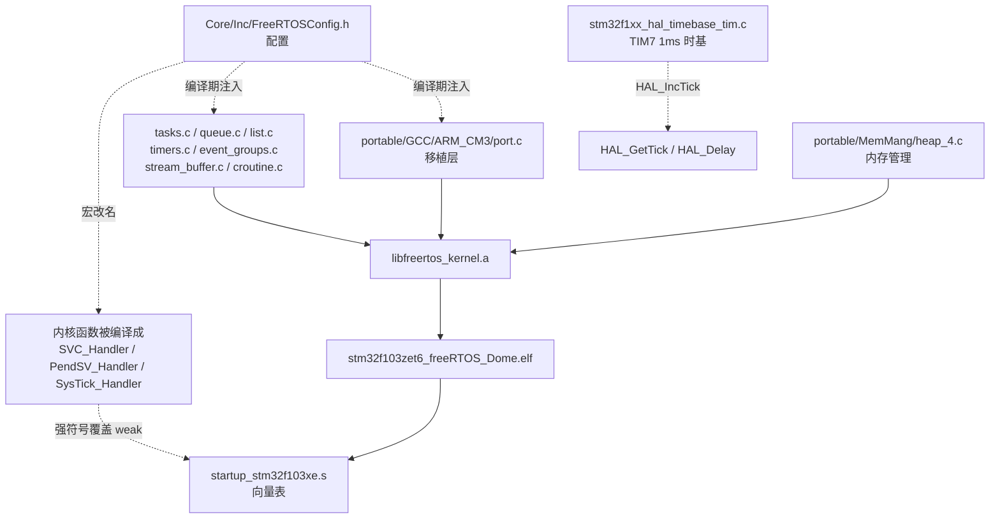

# FreeRTOS 移植步骤（STM32F103ZET6）

> [!abstract] 一句话概括
> 本工程以 **`stm32f103zet6_freeRTOS_Dome`** 为模板：CubeMX 只负责 MCU / 时钟 / 引脚 / USART1，FreeRTOS **手动接入**内嵌的 V11.3.1 最小集，中断路由采用**宏改名直接路由**，HAL 时基从 SysTick **搬到 TIM7**，把 SysTick 完整让给 RTOS。
> 一句话：**内核源码 + 一份 `FreeRTOSConfig.h` + 三个中断函数的归属**，HAL 与 CMSIS 一行不改。

> [!info] 工程坐标
> - 工程根目录：`/home/llsjjz/STM32CubeMX/project/stm32f103zet6_freeRTOS_Dome`
> - 工程名（CMake target / 产物名）：`stm32f103zet6_freeRTOS_Dome`
> - 内嵌内核：`extern/FreeRTOS/Source/`，约 **1.6 MB**，21 个头文件 + 7 个通用 `.c` + CM3 移植层 + `heap_4`
> - 工具链：`arm-none-eabi-gcc`，构建器 **Ninja**，预设 `Debug` / `Release`
> - CubeMX 版本：6.18.1（FW_F1 V1.8.7），生成目标 CMake
> - 烧录：`flash.cfg`（OpenOCD + ST-Link）

---

## 目录

- [[#0 移植总览]]
- [[#1 硬件与 HAL 前置]]
- [[#2 新建 FreeRTOSConfig.h]]
- [[#3 搬运内核源码到工程内]]
- [[#4 CMake 接入]]
- [[#5 中断路由（最关键）]]
- [[#6 任务与调度器]]
- [[#7 编译 / 烧录 / 验证]]
- [[#8 故障排查速查表]]
- [[#9 内存预算]]
- [[#10 本工程的已知待改进点]]
- [[#11 后续学习路线]]
- [[#12 关键参数对照表]]
- [[#相关笔记]]

---

## 0 移植总览

### 0.1 三层结构



| 层次 | 内容 | 验证方式 |
| --- | --- | --- |
| 构建层 | CMake 找到源码、选对移植层和堆 | 能编译出 `.elf` + `.hex` |
| 配置层 | `FreeRTOSConfig.h` 满足 V11 必填项 | 编译无 `#error` |
| 运行层 | 三个系统异常由内核接管 | PD1 的灯按 1 Hz 闪 |

### 0.2 与「C8T6 模板」的差异对照

> [!note] 从模板迁移过来时，最容易踩的四处
> | 项目 | C8T6 模板 | 本工程（ZET6） |
> | --- | --- | --- |
> | 启动文件 / 宏 | `startup_stm32f103xb.s` / `STM32F103xB` | `startup_stm32f103xe.s` / `STM32F103xE` |
> | 中断路由 | 方式 A：`it.c` 里转发调用 | **方式 B：宏改名直接路由** |
> | HAL 时基 | SysTick（10 ms 或 1 ms） | **TIM7**（`stm32f1xx_hal_timebase_tim.c`） |
> | LED | PC13 | **PD1**（PD2 也已配成输出） |
> | RAM / Flash | 20 KB / 64 KB | **64 KB / 512 KB** |
> | FreeRTOS 堆 | 8 KB | **36 KB** |
> | 编译系统 | Unix Makefiles | **Ninja + CMakePresets** |

### 0.3 需要改动的文件清单

| 文件 / 目录 | 操作 | 是否会被 CubeMX 覆盖 |
| --- | --- | --- |
| `extern/FreeRTOS/` | **新建**（官方包裁剪拷贝） | 否（不在生成范围） |
| `extern/FreeRTOS/CMakeLists.txt` | **新建**（自写） | 否 |
| `Core/Inc/FreeRTOSConfig.h` | **新建** | 否（自己建的文件） |
| `CMakeLists.txt`（顶层） | 追加 FreeRTOS 段落 | 否（只生成一次） |
| `Core/Src/stm32f1xx_it.c` | **删除** SVC / PendSV / SysTick 三个空函数 | ⚠️ 重新生成会**加回来**，需再删 |
| `Core/Src/main.c` | 改 `USER CODE` 块 | 块外覆盖，块内保留 |
| `.ioc` | `SYS → Timebase Source = TIM7` | 否（这是 MCU 配置） |

> [!warning] 不要在 CubeMX 里勾选 FreeRTOS
> CubeMX 自带的是 10.x 老版本，会生成 `Middlewares/Third_Party/FreeRTOS` 和一份**覆盖式**的 `FreeRTOSConfig.h`，与本工程手动接入的 LTS 11.3.1 直接冲突。`.ioc` 只用来管 MCU / 时钟 / 引脚 / NVIC / 时基源。

---

## 1 硬件与 HAL 前置

> [!tip] 目的
> FreeRTOS 与 HAL 抢的是同一颗 SysTick。先确认时基来源，否则会出现「`HAL_Delay()` 和 RTOS 互相打乱节拍」的经典问题。

### 1.1 本工程硬件参数

| 项目 | 值 | 来源 |
| --- | --- | --- |
| MCU | STM32F103ZET6，LQFP144 | `.ioc`：`Mcu.CPN` |
| Flash / RAM | 512 KB / 64 KB | `STM32F103xx_FLASH.ld` |
| 主频 | 72 MHz（HSE 8 MHz × PLL9） | `SystemClock_Config()` |
| APB1 / APB2 | 36 MHz / 72 MHz | `RCC.APB1CLKDivider = DIV2` |
| NVIC 优先级位数 | 4 位，分组 **NVIC_PRIORITYGROUP_4** | `.ioc`：`__NVIC_PRIO_BITS = 4` |
| 链接脚本栈 / 堆 | `_Min_Stack_Size = 0x400`（1 KB）/ `_Min_Heap_Size = 0x200`（512 B） | `.ld` |

### 1.2 HAL 时基为什么改成 TIM7

> [!important] 关键决策
> CubeMX 默认让 HAL 用 SysTick 做 1 ms 时基。但 FreeRTOS 也要独占 SysTick 做系统节拍——两者共用一个中断，会在 `SysTick_Handler` 里打架。
> 解决办法：在 `.ioc` 中把 `SYS → Timebase Source` 设成 **TIM7**，CubeMX 会生成 `Core/Src/stm32f1xx_hal_timebase_tim.c`，由 `HAL_InitTick()` 用 TIM7 产生 1 ms 中断，回调里调 `HAL_IncTick()`。

生成物 `stm32f1xx_hal_timebase_tim.c` 负责三件事：

```c
HAL_StatusTypeDef HAL_InitTick(uint32_t TickPriority)  /* 配 TIM7：72MHz→1MHz 计数→1ms 中断 */
void HAL_SuspendTick(void)                             /* 关 TIM7 更新中断 */
void HAL_ResumeTick(void)                              /* 开 TIM7 更新中断 */
```

`Core/Src/main.c` 里的回调：

```c
void HAL_TIM_PeriodElapsedCallback(TIM_HandleTypeDef *htim)
{
  if (htim->Instance == TIM7)
  {
    HAL_IncTick();        /* 维持 HAL_GetTick() / HAL_Delay() 超时机制 */
  }
}
```

> [!check] 动手前确认
> - [x] `MX_GPIO_Init()` 已使能 GPIOC / GPIOA / **GPIOD** 时钟，PD1 配成推挽输出
> - [x] `MX_USART1_UART_Init()`：PA9(TX) / PA10(RX)，115200 8N1，中断优先级 **5**
> - [x] `.ioc` 中 `NVIC.TimeBase = TIM7_IRQn`，TIM7 优先级 **15**
> - [x] `TICK_INT_PRIORITY = 15U`（`stm32f1xx_hal_conf.h`，即最低优先级）
> - [x] 裸机工程本身能编译、能烧录、能跑

> [!danger] 时基中断优先级不能高于 5
> 两处「tick」都要能调内核：RTOS 的 SysTick（内核自己设为最低 0xFF）与 HAL 的 TIM7。TIM7 现为 15，满足要求。若以后把 TIM7 调到 0~4，`HAL_IncTick()` 就会在无法被内核临界区屏蔽的中断里跑，引发隐蔽问题。

---

## 2 新建 FreeRTOSConfig.h

> [!tip] 目的
> 内核所有行为都由这个头文件决定。放在 `Core/Inc` 与 `main.h` 同级，且不属于 CubeMX 生成内容，重新生成不会被删。

本工程实际文件：`Core/Inc/FreeRTOSConfig.h`

```c
#ifndef FREERTOS_CONFIG_H
#define FREERTOS_CONFIG_H

#include "stm32f1xx.h"   /* SystemCoreClock 的来源 */

/* ===== Tick ===== */
#define configTICK_TYPE_WIDTH_IN_BITS           TICK_TYPE_WIDTH_32_BITS

/* ===== 调度 ===== */
#define configUSE_PREEMPTION                    1
#define configUSE_TIME_SLICING                  1
#define configUSE_PORT_OPTIMISED_TASK_SELECTION 1

/* ===== 时钟 ===== */
#define configCPU_CLOCK_HZ                      (SystemCoreClock)
#define configTICK_RATE_HZ                      ((TickType_t)1000)

/* ===== 中断优先级（Cortex-M3 只有 4 位有效） ===== */
#define configPRIO_BITS                         4
#define configLIBRARY_LOWEST_INTERRUPT_PRIORITY 15
#define configLIBRARY_MAX_SYSCALL_INTERRUPT_PRIORITY 5

#define configKERNEL_INTERRUPT_PRIORITY \
    ( configLIBRARY_LOWEST_INTERRUPT_PRIORITY << (8 - configPRIO_BITS) )
#define configMAX_SYSCALL_INTERRUPT_PRIORITY \
    ( configLIBRARY_MAX_SYSCALL_INTERRUPT_PRIORITY << (8 - configPRIO_BITS) )
/* 展开后：0xF0 与 0x50 */

/* ===== 任务 ===== */
#define configMAX_PRIORITIES                    (32)
#define configMINIMAL_STACK_SIZE                ((unsigned short)128)
#define configMAX_TASK_NAME_LEN                 (16)

/* ===== 内存 ===== */
#define configTOTAL_HEAP_SIZE                   ((size_t)(36 * 1024))
#define configSUPPORT_DYNAMIC_ALLOCATION        1
#define configSUPPORT_STATIC_ALLOCATION         0

/* ===== 钩子 ===== */
#define configUSE_IDLE_HOOK                     0
#define configUSE_TICK_HOOK                     0
#define configUSE_MALLOC_FAILED_HOOK            0
#define configCHECK_FOR_STACK_OVERFLOW          0

/* ===== 可选 API ===== */
#define INCLUDE_vTaskDelay                      1
#define INCLUDE_vTaskDelayUntil                 1
#define INCLUDE_vTaskDelete                     1
#define INCLUDE_vTaskSuspend                    1

#define configASSERT( x ) \
    if( ( x ) == 0 ) { taskDISABLE_INTERRUPTS(); for( ; ; ) ; }

/* ===== 方式 B：直接路由 ===== */
#define xPortPendSVHandler PendSV_Handler
#define vPortSVCHandler    SVC_Handler
#define xPortSysTickHandler SysTick_Handler

#endif /* FREERTOS_CONFIG_H */
```

### 2.1 逐项说明

| 配置 | 本工程值 | 说明 |
| --- | --- | --- |
| `configTICK_TYPE_WIDTH_IN_BITS` | 32 位 | V11 新写法，**不要**再写 `configUSE_16_BIT_TICKS`，两个同时定义会直接 `#error` |
| `configCPU_CLOCK_HZ` | `SystemCoreClock` | 比硬编码 `72000000UL` 更稳：`SystemClock_Config()` 改频率时自动跟随 |
| `configTICK_RATE_HZ` | 1000 | 1 个 tick = 1 ms，与 HAL 时基一致 |
| `configUSE_PORT_OPTIMISED_TASK_SELECTION` | 1 | CM3 有 `CLZ` 指令，用 32 位位图找最高优先级，比遍历快 |
| `configMAX_PRIORITIES` | **32** | ⚠️ 正好等于位图上限（`portmacro.h` 要求 ≤ 32）。改成 33 会编译报错 |
| `configLIBRARY_MAX_SYSCALL_INTERRUPT_PRIORITY` | 5 | 语义清晰：**数值 ≥ 5 的中断**才能调用 `xxxFromISR()` |
| `configTOTAL_HEAP_SIZE` | 36 KB | 64 KB RAM 下可用，见 [[#9 内存预算]] |
| `configMINIMAL_STACK_SIZE` | 128 字 = 512 B | 空闲任务栈 |
| `configASSERT` | 已定义 | 必须保留：`configCHECK_HANDLER_INSTALLATION` 默认是 1，见下 |

### 2.2 两个「看起来写了、其实没用到」的宏

> [!note]- 实测：`configKERNEL_INTERRUPT_PRIORITY` 与 `configPRIO_BITS` 内核并不读
> 在本工程的 `extern/FreeRTOS/Source` 里全量搜索：
> ```
> grep -rn "configKERNEL_INTERRUPT_PRIORITY" Source/   → 无结果
> grep -rn "configPRIO_BITS"                  Source/   → 无结果
> ```
> - `configKERNEL_INTERRUPT_PRIORITY` 是**旧版 FreeRTOS（V8 及更早）**的写法。CM3 的 `port.c` 现在自己用 `portMIN_INTERRUPT_PRIORITY (255)` 把 PendSV / SysTick 写进 SHPR 寄存器，不再读这个宏。
> - `configPRIO_BITS` 是 **CubeMX 模板遗留**的写法，内核不读它。
>
> 结论：这两个宏**写了无害、留着也行**，但它们**不构成生效的配置**。真正生效的是 `configMAX_SYSCALL_INTERRUPT_PRIORITY`。如果想让笔记更干净，可以删掉；但保留能提示读者「4 位优先级」这一硬件事实。

### 2.3 三个必须成立的约束

> [!danger] 别踩这三条
> **① `configMAX_SYSCALL_INTERRUPT_PRIORITY` 必须移到高 4 位（0x50）**
> Cortex-M3 的 NVIC 寄存器只用优先级字节的高 4 位，低 4 位是保留位。所以「优先级 5」要写 `5 << (8 - 4) = 0x50`。直接写 `5` 会让内核认为可屏蔽阈值是 0.3125，结果所有中断都被临界区屏蔽，行为完全错乱。本工程已用 `<< (8 - configPRIO_BITS)` 自动完成移位。
>
> **② 必须定义 `configASSERT`**
> `configCHECK_HANDLER_INSTALLATION` 默认为 **1**（见 `FreeRTOS.h:400`），而它为 1 时内核强制要求 `configASSERT` 已定义，否则编译期 `#error`。
>
> **③ 两种 tick 宽度宏不能同时定义**
> `configUSE_16_BIT_TICKS` 与 `configTICK_TYPE_WIDTH_IN_BITS` 二选一。

---

## 3 搬运内核源码到工程内

> [!tip] 目的
> 把内核变成工程**自己的一部分**：工程可独立打包分发，git 能追踪确切版本，原始源码包删掉也不影响编译。

### 3.1 为什么用最小集

| | **最小集**（本工程） | 整体拷贝 |
| --- | --- | --- |
| 体积 | 约 1.6 MB | 约 25 MB |
| 内容 | 7 个通用 `.c` + 21 个头文件 + CM3 移植层 + heap_4 | 全部，含 27 个移植端口 |
| 换芯片 | 手动补对应 `port.c` | 改一个 `FREERTOS_PORT` 变量 |
| 学习价值 | **高**：一眼看清内核由哪 9 个 `.c` 构成 | 低：27 个端口目录分散注意力 |

### 3.2 目标目录结构（本工程实际）

```text
extern/FreeRTOS/
├── CMakeLists.txt          # 自写，见第 4 章
├── LICENSE.md              # MIT 许可，必须保留
└── Source/
    ├── croutine.c
    ├── event_groups.c
    ├── list.c
    ├── queue.c
    ├── stream_buffer.c
    ├── tasks.c
    ├── timers.c
    ├── include/            # 21 个头文件
    │   ├── FreeRTOS.h  task.h  queue.h  semphr.h  timers.h
    │   ├── event_groups.h  stream_buffer.h  message_buffer.h
    │   ├── list.h  portable.h  projdefs.h  atomic.h
    │   └── deprecated_definitions.h  mpu_*.h  stack_macros.h  ...
    └── portable/
        ├── GCC/ARM_CM3/
        │   ├── port.c
        │   └── portmacro.h
        └── MemMang/
            └── heap_4.c
```

> [!check] 拷贝完整性自检
> ```bash
> find extern/FreeRTOS/Source/portable -type f | sort
> ```
> 应恰好三行：`GCC/ARM_CM3/port.c`、`GCC/ARM_CM3/portmacro.h`、`MemMang/heap_4.c`。
> 少 `port.c` → 链接报 `undefined reference to vPortSVCHandler`；少 `heap_4.c` → 报 `undefined reference to pvPortMalloc`。

### 3.3 拷贝命令（从官方 LTS 包裁剪）

```bash
cd /home/llsjjz/STM32CubeMX
K=FreeRTOSv202604.01-LTS/FreeRTOS-LTS/FreeRTOS/FreeRTOS-Kernel
D=project/stm32f103zet6_freeRTOS_Dome/extern/FreeRTOS/Source

mkdir -p $D/include $D/portable/GCC/ARM_CM3 $D/portable/MemMang

cp $K/croutine.c $K/event_groups.c $K/list.c $K/queue.c \
   $K/stream_buffer.c $K/tasks.c $K/timers.c $D/

cp $K/include/*.h $D/include/                     # 只拷 .h，跳过内部 CMakeLists.txt
cp $K/portable/GCC/ARM_CM3/{port.c,portmacro.h} $D/portable/GCC/ARM_CM3/
cp $K/portable/MemMang/heap_4.c                   $D/portable/MemMang/
cp $K/LICENSE.md                                  project/stm32f103zet6_freeRTOS_Dome/extern/FreeRTOS/
```

> [!warning] 不要 `cp -r $K/include/`
> 带斜杠递归会把内核内部的 `include/CMakeLists.txt`、`stdint.readme` 一起带进来，这些是给官方 `add_subdirectory` 用的，我们的构建不调用，留着只会误导。

> [!note] 保留原始源码包的用处
> 查宏 / 函数的原始实现与注释；以后换 `Cortex-M4F` 等芯片时，直接从 `$K/portable/GCC/ARM_CM4F/` 再拷一份即可，不必重新下载。

---

## 4 CMake 接入

> [!tip] 目的
> 用**自写**的 CMake 明确列出要编译的 9 个 `.c`，替代官方内核那套「从 27 个端口里自动挑一个」的机制——没有任何隐式选择。

### 4.1 顶层 `CMakeLists.txt`（追加两段）

```cmake
# ---- FreeRTOS ----
add_subdirectory(extern/FreeRTOS)

target_link_libraries(${CMAKE_PROJECT_NAME} 
    freertos_kernel)
```

顶层还额外生成 Intel HEX：

```cmake
add_custom_command(TARGET ${CMAKE_PROJECT_NAME} POST_BUILD
    COMMAND ${CMAKE_OBJCOPY} -O ihex
            $<TARGET_FILE:${CMAKE_PROJECT_NAME}>
            $<TARGET_FILE_DIR:${CMAKE_PROJECT_NAME}>/${CMAKE_PROJECT_NAME}.hex
    BYPRODUCTS ${CMAKE_PROJECT_NAME}.hex
)
```

> [!danger] 不要再写 `FREERTOS_PORT` / `FREERTOS_HEAP` / `freertos_config`
> 这三个是**官方内核 CMake** 的机制。`add_subdirectory` 指向的是我们自己的目录，写了不会生效，只会让人误以为还在用官方那套。

### 4.2 `extern/FreeRTOS/CMakeLists.txt`（本工程实际内容）

```cmake
# FreeRTOS Kernel V11.3.1 (LTS 202604.01) — 仅 Cortex-M3 / GCC
# 拷贝自 FreeRTOSv202604.01-LTS，按最小集裁剪

set(FREERTOS_DIR ${CMAKE_CURRENT_SOURCE_DIR}/Source)

add_library(freertos_kernel STATIC)

target_sources(freertos_kernel PRIVATE
    ${FREERTOS_DIR}/croutine.c
    ${FREERTOS_DIR}/event_groups.c
    ${FREERTOS_DIR}/list.c
    ${FREERTOS_DIR}/queue.c
    ${FREERTOS_DIR}/stream_buffer.c
    ${FREERTOS_DIR}/tasks.c
    ${FREERTOS_DIR}/timers.c
    ${FREERTOS_DIR}/portable/GCC/ARM_CM3/port.c
    ${FREERTOS_DIR}/portable/MemMang/heap_4.c
)

target_include_directories(freertos_kernel
    PUBLIC
        ${FREERTOS_DIR}/include
        ${FREERTOS_DIR}/portable/GCC/ARM_CM3
)

# 借用 stm32cubemx 接口库：已带上 Core/Inc、CMSIS 器件头文件和 STM32F103xE 宏
target_link_libraries(freertos_kernel PUBLIC stm32cubemx)

target_compile_features(freertos_kernel PUBLIC c_std_11)
target_compile_definitions(freertos_kernel PRIVATE projCOVERAGE_TEST=0)

# list.c 里大量指针强转，对严格别名敏感
target_compile_options(freertos_kernel PRIVATE -fno-strict-aliasing)
```

### 4.3 为什么这样写

> [!important] `target_link_libraries(freertos_kernel PUBLIC stm32cubemx)` 是点睛之笔
> `cmake/stm32cubemx/CMakeLists.txt` 定义了 `add_library(stm32cubemx INTERFACE)`，它携带三样东西：
> - 包含路径：`Core/Inc`、HAL 头文件、CMSIS 器件头文件
> - 宏：`USE_HAL_DRIVER`、**`STM32F103xE`**（注意是 xE 不是 xB）
> - Debug 配置下追加 `DEBUG`
>
> FreeRTOS 只依赖 `stm32cubemx` 这一个接口，就能找到 `FreeRTOSConfig.h`、`stm32f1xx.h` 和 `SystemCoreClock` 的声明——**不必**再手写一堆 `PRIVATE ../../Core/Inc` 的路径，也不会漏掉芯片宏。

> [!note] `-fno-strict-aliasing` 是干什么的
> `list.c` 里 `ListItem_t *` 与 `MiniListItem_t *` 之间有大量强制转换，两个结构体前几个成员布局相同但类型不同，属于典型的严格别名违规。`-O2` / `-Os` 下编译器可能做出错误优化。FreeRTOS 官方 demo 与多数厂商 SDK 都带这个选项。Debug（`-O0`）不加也没事，但**建议一直带着**。

> [!bug] 改了 CMake 路径后必须清缓存
> `build/Debug/CMakeCache.txt` 会残留 `add_subdirectory` 的旧绝对路径。增量配置**可能不报错**却仍指向旧目标，表现为「明明改了 CMake，行为却没变」。
> VS Code 里直接跑任务 **`CMake: 清理并重建`**：
> ```bash
> rm -rf build/Debug && cmake --preset Debug && cmake --build --preset Debug
> ```

---

## 5 中断路由（最关键）

> [!tip] 目的
> 这是移植真正的核心工作量，也是最容易「程序不动了」的地方。**本工程采用方式 B：宏改名直接路由。**

### 5.1 冲突从哪来

- `startup_stm32f103xe.s` 的向量表里放的是 `SVC_Handler` / `PendSV_Handler` / `SysTick_Handler`，且这三个是 **weak** 符号：
  ```asm
  .word SVC_Handler
  .word PendSV_Handler
  .word SysTick_Handler
  ...
  .weak SVC_Handler
  .thumb_set SVC_Handler, Default_Handler
  ```
- `Core/Src/stm32f1xx_it.c` 若定义了同名**强符号**，就会覆盖 weak，向量表实际指向 CubeMX 生成的空函数。
- FreeRTOS 内核导出的是 `vPortSVCHandler` / `xPortPendSVHandler` / `xPortSysTickHandler`。

> [!danger] 两套名字之间没有任何自动关联
> 不接，调度器一启动就 HardFault 或卡死。这就是新手最常见的「灯不闪 / 程序跑飞」原因。

### 5.2 方式 B 的机制（本工程采用）

`FreeRTOSConfig.h` 中：

```c
#define xPortPendSVHandler  PendSV_Handler
#define vPortSVCHandler     SVC_Handler
#define xPortSysTickHandler SysTick_Handler
```

> [!important] 宏是怎么生效的？
> `port.c` 编译时 `#include "FreeRTOS.h"` → 带上 `FreeRTOSConfig.h`，于是源码里的
> `void vPortSVCHandler( void )` 被**预处理器改名**成 `void SVC_Handler( void )`。
> 内核因此**直接产出强符号** `SVC_Handler`，向量表自动指向它。
>
> 注意：`stm32f1xx_it.c` **不包含** `FreeRTOSConfig.h`，它看到的是原始代码。所以改名只影响内核，不影响应用文件——这正是方式 B 干净的地方。

### 5.3 必须删掉 CubeMX 生成的三个空函数

本工程 `Core/Src/stm32f1xx_it.c` 里，这三处**只剩注释、没有函数体**——这是方式 B 的必要条件：

```c
/* 本工程实际状态：函数被删除，只剩悬空注释 */
/**
  * @brief This function handles System service call via SWI instruction.
  */

/**
  * @brief This function handles Pendable request for system service.
  */

/**
  * @brief This function handles System tick timer.
  */
```

> [!warning] 重新用 CubeMX 生成代码后必须复查
> CubeMX 会把 `SVC_Handler` / `PendSV_Handler` / `SysTick_Handler` **加回来**，与内核改名后的强符号**重复定义**，链接报：
> ```
> multiple definition of `SVC_Handler'
> ```
> 每次 Generate Code 之后，检查 `stm32f1xx_it.c` 是否又出现这三个函数，出现就删掉函数体（保留 `USER CODE` 块）。
>
> `stm32f1xx_it.h` 里仍保留 `void SVC_Handler(void);` 等声明，**无害**，不用删。

### 5.4 方式 A 与方式 B 的取舍

| | 方式 A：间接路由 | 方式 B：直接路由（**本工程**） |
| --- | --- | --- |
| 做法 | `it.c` 里写 `vPortSVCHandler();` 转发 | `FreeRTOSConfig.h` 里 `#define` 改名 |
| 代码位置 | `USER CODE` 块内 | 配置文件 |
| 扛 CubeMX 重新生成 | ✅ 能（块内保留） | ❌ 需手动再删一次 |
| `configCHECK_HANDLER_INSTALLATION` | 必须 `0` | 保持默认 **1**（内核会校验向量表） |
| 开销 | 多一次函数跳转 | 无额外开销 |
| 内核自检 | 关闭 | **开启**：`xPortStartScheduler()` 启动前比对 VTOR 向量表 |

> [!example] 方式 A 的写法（备查）
> ```c
> /* stm32f1xx_it.c — USER CODE BEGIN PFP */
> extern void vPortSVCHandler( void );
> extern void xPortPendSVHandler( void );
> extern void xPortSysTickHandler( void );
>
> void SVC_Handler(void)      { vPortSVCHandler(); }
> void PendSV_Handler(void)   { xPortPendSVHandler(); }
> void SysTick_Handler(void)  { xPortSysTickHandler(); }
> ```
> 同时 `FreeRTOSConfig.h` 里**删掉**那三行 `#define` 改名，并把 `configCHECK_HANDLER_INSTALLATION` 设为 `0`。
> GCC 14 起隐式函数声明是 error，方式 A **必须**自己写 `extern` 声明（内核头文件不声明这三个函数）。

### 5.5 本工程的自检资产

> [!success] 已实测：直接路由自检通过
> `xPortStartScheduler()` 在 `configCHECK_HANDLER_INSTALLATION == 1` 时会执行：
> ```c
> configASSERT( pxVectorTable[ portVECTOR_INDEX_SVC ]    == vPortSVCHandler );
> configASSERT( pxVectorTable[ portVECTOR_INDEX_PENDSV ] == xPortPendSVHandler );
> ```
> 本工程能正常跑起来，说明这两个断言都通过了——即向量表确实指向内核函数。
> 编译产物符号表也印证：
> ```
> 0800338c T SVC_Handler
> 08003608 T PendSV_Handler
> 08003650 T SysTick_Handler
> ```
> 它们都是 `T`（代码段强符号），不是 `Weak`。

> [!note]- 为什么 SysTick 不做自检
> `port.c` 的注释写明：应用可能用**定时器代替 SysTick** 充当 RTOS 节拍（覆写 `vPortSetupTimerInterrupt()`），所以内核不检查 SysTick 的安装情况。本工程仍用 SysTick 做节拍，只是 HAL 时基搬到了 TIM7。

### 5.6 三个异常分别管什么

| 异常 | 内核函数（改名后） | 触发时机 | 职责 |
| --- | --- | --- | --- |
| SVCall | `vPortSVCHandler` → `SVC_Handler` | 启动调度器时 `svc 0` 一次 | 装载第一个任务上下文，从 MSP 切到 PSP |
| PendSV | `xPortPendSVHandler` → `PendSV_Handler` | 每次需要切任务时被挂起 | 保存当前任务寄存器，恢复下一个任务 |
| SysTick | `xPortSysTickHandler` → `SysTick_Handler` | 每 1 ms | 递增 tick，到点挂起 PendSV |

> [!note]- 为什么用 PendSV 做上下文切换
> PendSV 是 Cortex-M 中优先级可设成最低的系统异常。设到最低，可以让**所有**中断先处理完再切任务，避免在中断嵌套中间切栈。`xPortStartScheduler()` 会自动把 PendSV / SysTick 写入 SHPR 寄存器并设为 `0xFF`。

### 5.7 SysTick 里不再调用 `HAL_IncTick()`

> [!important] 这是本工程与 C8T6 模板最大的行为差异
> 模板里 `SysTick_Handler` 既要 `HAL_IncTick()` 又要 `xPortSysTickHandler()`。本工程 **SysTick 归内核独占**，HAL 的 1 ms 计数由 TIM7 中断经 `HAL_TIM_PeriodElapsedCallback()` 完成。
> 所以 `HAL_GetTick()` / `HAL_Delay()` 依然正常——前提是 `.ioc` 的 Timebase 保持 TIM7。

---

## 6 任务与调度器

### 6.1 `Core/Src/main.c` 改动（本工程实际）

#### (1) `USER CODE BEGIN Includes`

```c
#include "FreeRTOS.h"
#include "task.h"
#include "queue.h"   /* 后续用队列时保留 */
```

#### (2) `USER CODE BEGIN 0` —— 任务函数

```c
void vTaskLED(void *pvParameters) {
  for (;;) {
    HAL_GPIO_TogglePin(GPIOD, GPIO_PIN_1);
    vTaskDelay(500);   /* 500 tick = 500 ms（configTICK_RATE_HZ = 1000） */
  }
}
```

#### (3) `USER CODE BEGIN 2` —— 建任务、启调度器

```c
  /* USER CODE BEGIN 2 */
  xTaskCreate(vTaskLED, "LED_Task", 128, NULL, 2, NULL);

  vTaskStartScheduler();   /* 正常永远不返回 */
  /* USER CODE END 2 */
```

> [!info] 为什么不用手动开 GPIO 时钟
> 本工程 LED 在 **PD1**，已在 CubeMX 里配成 `GPIO_Output`（推挽、无上下拉、Medium 速度），`MX_GPIO_Init()`（位于 `Core/Src/gpio.c`）已经完成时钟使能和引脚配置。不需要像模板那样在 `main()` 里补 `__HAL_RCC_GPIOD_CLK_ENABLE()`。

### 6.2 参数说明

```c
BaseType_t xTaskCreate(
    TaskFunction_t pvTaskCode,          // 任务函数指针
    const char * const pcName,          // 任务名（调试用，长度受 configMAX_TASK_NAME_LEN 限制）
    configSTACK_DEPTH_TYPE usStackDepth,// 栈深度，单位是【字】不是字节
    void * const pvParameters,          // 传给任务的参数
    UBaseType_t uxPriority,             // 优先级，0 最低
    TaskHandle_t * const pxCreatedTask  // 句柄，不需要就传 NULL
);
```

> [!warning] 栈深度单位是「字」
> `128` = 128 × 4 = **512 字节**。一个只点灯 + `vTaskDelay` 的任务够用；带 `printf` 的任务建议 ≥ 256 字。
> 本工程 `configMAX_PRIORITIES = 32`，优先级写 `2` 合法；但注意 `uxPriority` 必须 `< 32`。

> [!important] 任务函数不能返回
> FreeRTOS 没有「任务退出」的概念，函数返回会触发 `prvTaskExitError()` 里的死循环。要结束任务用 `vTaskDelete(NULL)`。

### 6.3 `while(1)` 去哪了

`vTaskStartScheduler()` 之后永远不返回，`main()` 末尾的 `while(1)` 已是死代码，留着无害。

> [!note] 严格说有一种情况会返回
> `configTOTAL_HEAP_SIZE` 不够导致 Idle 任务创建失败时，`vTaskStartScheduler()` 会返回。本工程没开 `configUSE_MALLOC_FAILED_HOOK`，返回后直接落到 `while(1)` 静默失联——这也是 [[#10 本工程的已知待改进点]] 里建议开钩子的原因。

---

## 7 编译 / 烧录 / 验证

### 7.1 命令行

```bash
cd /home/llsjjz/STM32CubeMX/project/stm32f103zet6_freeRTOS_Dome

cmake --preset Debug
cmake --build --preset Debug        # 或 cmake --build build/Debug -j
arm-none-eabi-size build/Debug/stm32f103zet6_freeRTOS_Dome.elf
openocd -f flash.cfg
```

### 7.2 VS Code 任务（`.vscode/tasks.json`）

| 任务 | 作用 |
| --- | --- |
| `CMake: 配置 Debug` | `cmake --preset Debug` |
| `CMake: 构建 Debug` | `cmake --build --preset Debug`（默认构建任务） |
| `CMake: 清理并重建` | 删 `build/Debug` 后重新配置 + 构建 |
| `OpenOCD: 烧录` | `openocd -f flash.cfg` |

### 7.3 实测结果

> [!success] 本工程构建产物的真实占用
> ```
>    text    data     bss     dec     hex   filename
>   15792      16   39416   55224    d7b8   stm32f103zet6_freeRTOS_Dome.elf
> ```
> | 区域 | 用量 | 容量 | 占比 |
> | --- | --- | --- | --- |
> | Flash（text + data） | 15 808 B | 512 KB | ≈ 3.0% |
> | RAM（data + bss） | 39 432 B | 64 KB | ≈ 60.2% |
> | 加上链接器预留的 `_Min_Heap_Size`(512 B) + `_Min_Stack_Size`(1 KB) | ≈ 41.0 KB | 64 KB | ≈ 62.5% |
>
> `bss` 之所以近 39 KB，是因为 `ucHeap` 独占 **0x9000 = 36 KB**：
> ```
> .bss.ucHeap   0x200003e8   0x9000   extern/FreeRTOS/libfreertos_kernel.a(heap_4.c.obj)
> ```

### 7.4 确认内核真的被链接进来

```bash
arm-none-eabi-nm build/Debug/stm32f103zet6_freeRTOS_Dome.elf \
  | grep -E "vTaskStartScheduler|xPortPendSVHandler|ucHeap|pxCurrentTCB"
```

| 符号 | 应出现 | 含义 |
| --- | --- | --- |
| `vTaskStartScheduler` | ✅ | 调度器主体已链接 |
| `SVC_Handler` / `PendSV_Handler` / `SysTick_Handler` | ✅ 且为 `T` | 宏改名后的内核强符号已接管向量表 |
| `pxCurrentTCB` | ✅（`B` 段） | 当前任务指针，调度器运行核心变量 |
| `ucHeap` | ✅ 大小 0x9000 | FreeRTOS 堆 = `configTOTAL_HEAP_SIZE` |

> [!tip] 注意搜不到 `xPortPendSVHandler`
> 因为宏改名发生在预处理阶段，最终符号名是 `PendSV_Handler`。这也是一种「直接路由生效」的证据。

### 7.5 现象判定

> [!success] 成功的标志
> **PD1 上的灯以 1 Hz（500 ms 亮 / 500 ms 灭）稳定闪烁**，且 USART1（PA9）115200 8N1 可用。

### 7.6 调试器看当前任务（可选）

```bash
openocd -f flash.cfg &
arm-none-eabi-gdb build/Debug/stm32f103zet6_freeRTOS_Dome.elf -ex "target remote :3333"
```

GDB 里 `p pxCurrentTCB->pcTaskName` 能看到当前任务名，比盲看灯更直接。

---

## 8 故障排查速查表

> [!bug] 按现象对号入座

### 8.1 编译 / 配置错误

| 报错 / 现象 | 原因 | 解决 |
| --- | --- | --- |
| `add_subdirectory` 路径不存在 | `extern/FreeRTOS/` 没建或没拷全 | 按 [[#3 搬运内核源码到工程内]] 重拷 |
| `fatal error: FreeRTOS.h: No such file` | `Source/include/` 没拷全 | 检查 `cp $K/include/*.h` |
| `#error Missing definition: configXXX` | `FreeRTOSConfig.h` 缺必填项 | 对照 [[#2 新建 FreeRTOSConfig.h]] 补齐 |
| `#error Only one of configUSE_16_BIT_TICKS and configTICK_TYPE_WIDTH_IN_BITS` | 两个都写了 | 删掉 `configUSE_16_BIT_TICKS` |
| `#error You must define configASSERT()...` | 没定义 `configASSERT` | 补上（方式 B 下 `configCHECK_HANDLER_INSTALLATION` 保持 1） |
| `#error configUSE_PORT_OPTIMISED_TASK_SELECTION can only be set to 1 when configMAX_PRIORITIES ... <= 32` | 优先级数量超过 32 | 降到 ≤ 32，或把该选项设 0 |
| `undefined reference to pvPortMalloc` | `target_sources` 漏了 `heap_4.c` | 补进 `extern/FreeRTOS/CMakeLists.txt` |
| `undefined reference to vPortSVCHandler` | 漏了 `port.c` | 同上 |
| **`multiple definition of 'SVC_Handler'`** | CubeMX 重新生成了三个空函数 | 删掉 `stm32f1xx_it.c` 里的函数体（[[#5.3 必须删掉 CubeMX 生成的三个空函数]]） |
| `implicit declaration of function 'vPortSVCHandler'` | 只在方式 A 下出现 | 方式 A 需补 `extern` 声明 |
| `fatal error: stm32f1xx.h: No such file` | `freertos_kernel` 没链接 `stm32cubemx` | 恢复 `target_link_libraries(freertos_kernel PUBLIC stm32cubemx)` |
| `region RAM overflowed` | 堆太大 | 降 `configTOTAL_HEAP_SIZE` |
| 改了 CMake 但行为没变 | `build/` 缓存残留 | 跑 `CMake: 清理并重建` |

> [!note]- 历史条目（用官方内核 CMake 时才可能出现，本项目已不使用）
> | 报错 | 原因 | 解决 |
> | --- | --- | --- |
> | `FATAL_ERROR: freertos_config target not specified` | 缺 `add_library(freertos_config INTERFACE)` | 补上该目标 |
> | `undefined reference to pthread_*` 等主机符号 | 没设 `FREERTOS_PORT`，落了 `GCC_POSIX` | 设 `FREERTOS_PORT=GCC_ARM_CM3` |
> | `undefined reference to pvPortMalloc` | 没设 `FREERTOS_HEAP` | `set(FREERTOS_HEAP 4 CACHE STRING "")` |

### 8.2 运行时错误

| 现象 | 原因 | 解决 |
| --- | --- | --- |
| 什么都不跑，停在启动处 | 卡在 `SystemClock_Config()` 的 `Error_Handler()`（HSE 未起振） | 检查晶振 / 改 HSI |
| 进 `HardFault_Handler` | SVC / PendSV 没接管（方式 B 下多半是三个函数没删干净或宏没生效） | 对照 [[#5 中断路由（最关键）]] |
| 卡在 `configASSERT` 的 `for(;;)` | 向量表自检失败 / 参数错误 | 调试器看 Call Stack；改 `__BKPT(0)` 版本断点 |
| 灯闪一下就不动了 | 任务里用 `HAL_Delay()` 忙等 | 改用 `vTaskDelay()` |
| 灯完全不亮 | LED 引脚 / 端口不对（本工程是 **PD1**，不是 PC13） | 核对 `gpio.c` 与 `.ioc` |
| `HAL_Delay()` 永不返回 | TIM7 时基没起来 / `HAL_TIM_PeriodElapsedCallback` 丢了 | 检查 `.ioc` Timebase = TIM7 |
| 灯闪得极快 / 极慢 | `configCPU_CLOCK_HZ` 与实际主频不符 | 本工程用 `SystemCoreClock`，检查时钟树 72 MHz |
| 在 `HAL_Delay()` 里感觉「卡死上千 ms」 | 任务调用了阻塞式 HAL 函数 | 改用中断 / DMA + 信号量 |

> [!tip] 卡在 `configASSERT` 时怎么定位
> `configASSERT` 先 `taskDISABLE_INTERRUPTS()` 再死循环。用调试器暂停看 Call Stack 能直接看到失败的断言。改成带断点的版本更快：
> ```c
> #define configASSERT( x ) if( ( x ) == 0 ) { __BKPT(0); for( ; ; ) ; }
> ```

---

## 9 内存预算

> [!info] 64 KB RAM 的分配现状
> `configTOTAL_HEAP_SIZE` + 主栈 + `_Min_Heap_Size` + `.data/.bss` 全部挤在 64 KB 内。本工程 FreeRTOS 堆取 **36 KB**，实测总 RAM 占用约 **41 KB（62.5%）**，仍有约 23 KB 余量。

| 项目 | 大小 | 说明 |
| --- | --- | --- |
| `_Min_Stack_Size` | 1 KB（0x400） | MSP，中断与启动阶段用 |
| `_Min_Heap_Size` | 512 B（0x200） | newlib `_sbrk` 用 |
| `.data + .bss`（不含 `ucHeap`） | ≈ 2.5 KB | HAL 句柄、`huart1`、`htim7` 等 |
| FreeRTOS 堆 `ucHeap` | **36 KB**（0x9000） | 任务栈 + TCB + 队列都从这里分配 |
| **合计** | **≈ 41 KB** | 剩余约 23 KB |

### 9.1 堆占用估算

> [!note] 本工程 `configUSE_TIMERS` 未定义 → 默认 **0**
> 这意味着**没有定时器服务任务**，也就少了 ≈ 1 KB 的固定开销。用到 `xTimerCreate()` 时必须先把它设为 1，并补齐 `configTIMER_TASK_PRIORITY` / `configTIMER_QUEUE_LENGTH` / `configTIMER_TASK_STACK_DEPTH`。

| 对象 | 大小（约） |
| --- | --- |
| Idle 任务 | TCB + `configMINIMAL_STACK_SIZE`(512 B) ≈ 600 B |
| 每个业务任务（128 字栈） | ≈ 600 B |
| 队列（后续） | 每项 4 B × 长度 + 固定头 ≈ 100 B 起 |
| 互斥量 / 信号量 | ≈ 100 B 每个 |

### 9.2 观察手段

```c
#include "FreeRTOS.h"
#include "task.h"

size_t free = xPortGetFreeHeapSize();   /* 剩余堆 */
```

任务表的打印需要打开统计功能（会额外占 RAM 与 Flash）：

```c
#define configUSE_TRACE_FACILITY                 1
#define configUSE_STATS_FORMATTING_FUNCTIONS     1
```

> [!tip] 栈余量怎么看
> `uxTaskGetStackHighWaterMark(handle)` 返回任务生命周期内栈的**最小剩余量**（单位：字）。接近 0 就该加栈。需先打开 `INCLUDE_uxTaskGetStackHighWaterMark 1`。

---

## 10 本工程的已知待改进点

> [!warning] 以下是阅读代码时发现的可优化项，不影响当前「灯能闪」，但建议逐步处理
> 1. **`vTaskDelay(500)` 写死 tick 数**：`configTICK_RATE_HZ` 一旦不是 1000，延时就不再是 500 ms。建议改为 `vTaskDelay( pdMS_TO_TICKS( 500 ) )`。
> 2. **`vTaskLED` 的 `pvParameters` 未使用**：加 `( void ) pvParameters;` 更干净；若开启 `-Wunused-parameter` 也能消除告警。
> 3. **注释与引脚不符**：`main.c` 里写着「假设LED连接在PD0引脚」，实际是 **PD1**；`gpio.c` 还配置了 PD2（输出）与 PD3/PD4（上拉输入），目前没有用到。建议同步注释，或在 CubeMX 里清理未用引脚。
> 4. **`configUSE_MALLOC_FAILED_HOOK` 与 `configCHECK_FOR_STACK_OVERFLOW` 都是 0**：学习阶段建议临时打开（2 号检查即 `configCHECK_FOR_STACK_OVERFLOW = 2`），能第一时间抓到内存/栈问题。
> 5. **`configMAX_PRIORITIES = 32` 贴着上限**：当前能编过，但以后改大就会触发 `#error`。若真不打算用这么多级，降到 7~10 更省 RAM。
> 6. **`configKERNEL_INTERRUPT_PRIORITY` / `configPRIO_BITS` 是无效配置**（内核不读，见 [[#2.2 两个「看起来写了、其实没用到」的宏]]）。保留作说明可以，但别误以为改了它们会生效。
> 7. **`INCLUDE_xTaskGetSchedulerState` 未开**：目前不影响。注：`tasks.c:6703` 的条件是 `INCLUDE_xTaskGetSchedulerState == 1 || configUSE_TIMERS == 1`，所以启用软件定时器后该函数会**自动**编译进来，只需补上 `configTIMER_TASK_PRIORITY` / `configTIMER_QUEUE_LENGTH` / `configTIMER_TASK_STACK_DEPTH` 三项即可。

---

## 11 后续学习路线

> [!todo] 进度清单
> - [x] 裸机工程跑通（编译 / 烧录 / 时钟 / TIM7 时基）
> - [x] 接入内核源码 + `FreeRTOSConfig.h`，编译通过
> - [x] 中断路由（方式 B），`vTaskStartScheduler()` 跑起 Idle 与 LED 任务
> - [ ] 两个不同优先级的任务（LED + 串口），观察抢占
> - [ ] 队列 `xQueueCreate`
> - [ ] 信号量 / 互斥量
> - [ ] 软件定时器（需打开 `configUSE_TIMERS`）
> - [ ] 事件组
> - [ ] 中断中调 API（`xxxFromISR`）

### 11.1 各阶段要点

**① 两个任务 + 不同优先级**
直观看到抢占式调度：高优先级任务不阻塞时，低优先级任务永远得不到 CPU（即「饿死」）。

**② 队列 `xQueueCreate`**
一个任务产数据、一个任务消费，理解**阻塞唤醒**——接收任务在队列空时进入 Blocked 态并让出 CPU。

**③ 互斥量 `xSemaphoreCreateMutex`**
保护共享变量。互斥量有**优先级继承**，二值信号量没有——这是面试常考点。

**④ 软件定时器 `xTimerCreate`**
回调运行在**定时器服务任务**上下文，不是中断，所以能用普通 API，但**不能阻塞**。启用前先打开 `configUSE_TIMERS`。

**⑤ 中断里调 API**
按键中断里 `xSemaphoreGiveFromISR` + `portYIELD_FROM_ISR()`。这一步会真正用上 `configMAX_SYSCALL_INTERRUPT_PRIORITY`，也是理解 NVIC 优先级分组最好的机会。本工程 USART1 中断优先级为 5，正好满足条件，可直接在 `USART1_IRQHandler` 里试。

> [!danger] 中断优先级的硬约束
> **凡是调用 `xxxFromISR()` 的中断，其 NVIC 抢占优先级数值必须 ≥ 5**（数值越大优先级越低）。
> 原因：优先级高于 `configMAX_SYSCALL_INTERRUPT_PRIORITY` 的中断不会被内核临界区屏蔽，所以它们**不能**碰内核数据结构。
> 本工程：TIM7 = 15 ✅、USART1 = 5 ✅。以后在 CubeMX 里新增中断，别设成 0~4。

---

## 12 关键参数对照表

| 参数 | 本工程值 | 依据 |
| --- | --- | --- |
| `configCPU_CLOCK_HZ` | `SystemCoreClock`（= 72 MHz） | `SystemClock_Config()`：HSE 8 MHz × PLL9 |
| `configTICK_RATE_HZ` | 1000 | 1 tick = 1 ms |
| `configLIBRARY_MAX_SYSCALL_INTERRUPT_PRIORITY` | 5 | 展开为 `0x50` |
| `configMAX_SYSCALL_INTERRUPT_PRIORITY` | `5 << (8-4)` = 0x50 | 4 位优先级 |
| `configKERNEL_INTERRUPT_PRIORITY` | `15 << (8-4)` = 0xF0 | 模板写法，内核不读 |
| `configMAX_PRIORITIES` | 32 | 位图上限，不可再增 |
| `configMINIMAL_STACK_SIZE` | 128 字（512 B） | Idle 任务栈 |
| `configTOTAL_HEAP_SIZE` | 36 KB | 64 KB RAM 下实测占 62.5% |
| `configUSE_TIMERS` | 未定义 → 0 | 暂无定时器任务 |
| HAL 时基 | TIM7，1 ms，优先级 15 | `.ioc` / `stm32f1xx_hal_timebase_tim.c` |
| 中断路由 | 宏改名直接路由 | `FreeRTOSConfig.h` 末尾三行 `#define` |
| 内核源码位置 | `extern/FreeRTOS/Source/` | 内嵌，约 1.6 MB |
| 移植层 | `Source/portable/GCC/ARM_CM3/port.c` | Cortex-M3 无 FPU |
| 内存管理 | `Source/portable/MemMang/heap_4.c` | 支持释放、碎片少 |
| 内核版本 | V11.3.1（LTS 202604.01） | `task.h`：`tskKERNEL_VERSION_NUMBER` |
| 芯片宏 | `STM32F103xE` | `cmake/stm32cubemx/CMakeLists.txt` |
| 启动文件 | `startup_stm32f103xe.s` | 工程根目录 |

---

## 相关笔记

- [[FreeRTOS 队列笔记]] —— 任务间通信的下一步
- [[STM32 CubeMX 工程结构]] —— `.ioc` / CMake / 生成代码块（`USER CODE`）机制
- [[Cortex-M3 异常与 NVIC]] —— SVC / PendSV / SysTick 与优先级分组

> [!info] 外部参考
> - 配置项官方说明：<https://www.freertos.org/a00110.html>
> - 移植 FAQ：<https://www.freertos.org/Why-FreeRTOS/FAQs>
> - 工程内内核源码：`extern/FreeRTOS/Source/`
> - 工程内移植层：`extern/FreeRTOS/Source/portable/GCC/ARM_CM3/port.c`
> - 工程内内存管理：`extern/FreeRTOS/Source/portable/MemMang/heap_4.c`
> - 原始源码包（参考，不参与构建）：`FreeRTOSv202604.01-LTS/FreeRTOS-LTS/FreeRTOS/FreeRTOS-Kernel/`

---

## 变更记录

| 日期 | 内容 |
| --- | --- |
| 2026-10-22 | 初稿（基于 STM32F103C8T6 模板工程编写） |
| 2026-11-01 | 内核改为内嵌：新增「搬运内核源码」，CMake 改为自写方案，删除 `FREERTOS_PORT` / `FREERTOS_HEAP` / `freertos_config` |
| 2026-11-02 | **以 `stm32f103zet6_freeRTOS_Dome` 为模板全面更新**：平台改为 ZET6（512 KB Flash / 64 KB RAM）；中断路由改为**宏改名直接路由（方式 B）**并说明 CubeMX 重生成后的重复定义风险；HAL 时基改为 **TIM7**；LED 改为 **PD1**；堆改为 **36 KB**；CMake 改为复用 `stm32cubemx` 接口库；补充实测内存数字、符号验证、已知待改进点；全篇改为 Obsidian 风格（属性 / Callout / 双链 / Mermaid） |