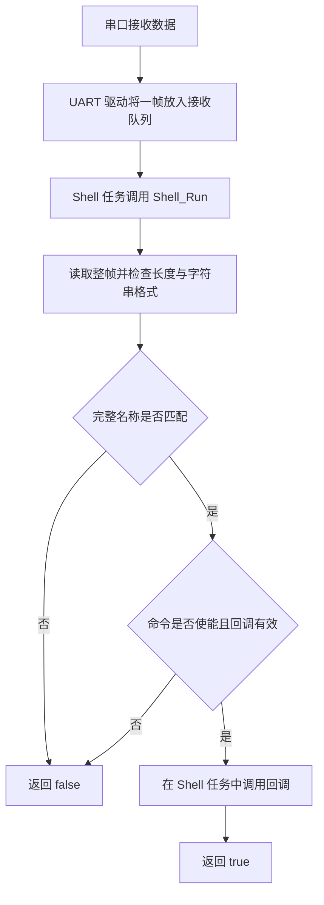

# STM32 Shell 库建立与优化学习笔记

> [!abstract] 学习目标
> 从“收到串口数据后调用一个函数”出发，建立一个最小命令库。通过修复初版代码，掌握数组容量、指针传参、字符串边界、回调函数、状态一致性和 FreeRTOS 任务接入。
>
> 这里的 shell 是无参数串口命令分发器。当前支持 `ping`、`help` 等完整名称，不包含命令行编辑、历史记录或参数解析。

## 目录

- [[#1 工程结构与执行流程]]
- [[#2 先确定数据结构和接口约定]]
- [[#3 数组与指针 为什么容量必须显式传入]]
- [[#4 函数指针与输出参数]]
- [[#5 字节数据如何变成合法字符串]]
- [[#6 初始化与注册如何保持状态正确]]
- [[#7 输出格式化与边界检查]]
- [[#8 FreeRTOS 接入与内存知识]]
- [[#9 如何验证一个小型库]]
- [[#10 修改与知识点速查表]]
- [[#11 当前限制与后续学习路线]]
- [[#12 自测与练习]]

## 1 工程结构与执行流程

### 1.1 各文件负责什么

以下路径相对于本笔记所在的工程根目录。将整个工程作为 Obsidian 仓库或保持目录结构时，可按相对路径定位源码。

| 文件 | 职责 |
| --- | --- |
| [shell.h](func/Inc/shell.h) | 数据类型、长度限制、对外函数声明、使用约定 |
| [shell.c](func/Src/shell.c) | 初始化、注册、接收、查找、执行、使能控制和列表输出 |
| [func_uart_0.h](func/Inc/func_uart_0.h) / [func_uart_0.c](func/Src/func_uart_0.c) | UART 帧收发、队列和 DMA 配合 |
| [vTaskShell.c](func/Src/vTaskShell.c) | `ping`、`help` 回调及周期执行任务 |
| [vTaskShell.h](func/Inc/vTaskShell.h) | 应用初始化、任务入口、任务栈和优先级声明 |
| [func.c](func/Src/func.c) | 初始化 UART、初始化命令表、创建任务、启动调度器 |
| [func/CMakeLists.txt](func/CMakeLists.txt) | 将 shell 和任务实现加入构建 |



建立这个库的顺序是：**约定数据布局 → 声明接口 → 实现注册与查找 → 接收并解析输入 → 执行回调 → 接入任务 → 验证边界**。

> [!tip] 应学会的分层思路
> UART 层管理字节与帧，shell 层管理命令匹配，应用回调执行具体动作。修改 LED 功能时，应优先改回调，而不是把 LED 逻辑塞进通用查找函数。
>
> 当前 `shell.c` 仍直接依赖 `func.h` 和全局 `uart1`，因此只是初步分层，还不是完全独立于平台的库。

## 2 先确定数据结构和接口约定

### 2.1 一个表项包含什么

```c
typedef struct {
    const char *name;
    void (*func)(void);
    unsigned char count;
} Shell_t;
```

| 字段 | 含义 | 应学习的知识 |
| --- | --- | --- |
| `name` | 指向命令名，不复制名称内容 | 指针、只读访问、对象生命周期 |
| `func` | 指向命令处理函数 | 函数指针与回调 |
| `count` | 0 号项保存数量，其他项保存使能状态 | 数据布局与接口约定 |

为减少修改，当前保留了 `count` 在不同位置承担不同含义的设计。今后若扩展多个 shell 实例，可以把数量和容量提取为独立管理结构；现阶段先保持约定一致。

### 2.2 表的布局

```c
static Shell_t commands[9];
```

| 数组位置 | 用途 |
| --- | --- |
| `commands[0]` | 管理项，`count` 保存已注册数量 `N` |
| `commands[1]` | 第 1 条命令，`count` 为 0 或 1 |
| `commands[2]` | 第 2 条命令 |
| `commands[N]` | 最后一条已注册命令 |
| 后续位置 | 尚未使用，不参与查找和执行 |

因此，9 个表项最多容纳 **8 条命令**。在本 STM32 平台上，数量字段最多表示 255，实际命令上限是 `min(capacity - 1, 255)`。

需要始终成立的条件称为**不变量**：

- 注册成功后，有效命令恰好位于 `1..N`。
- `N` 小于真实数组容量。
- 注册失败时，已注册数量不变。
- 0 号项不参与匹配、禁用或执行。
- 名称有效且唯一，被禁用的命令仍占用名称和表项。

### 2.3 接口一览

| 接口 | 使用方式与返回含义 |
| --- | --- |
| `Shell_Init(list, capacity, name, func)` | 初始化并注册首条命令，成功返回 `true` |
| `Shell_Register(list, capacity, name, func)` | 添加命令，重复、满表或参数无效时返回 `false` |
| `Shell_Run(list)` | 消费至多一帧，匹配并调用回调后返回 `true` |
| `Shell_GetCount(list)` | 获取已注册总数，包含禁用项 |
| `Shell_Set(list, number, count)` | 按 1 起始索引设置使能；0 表示禁用，非 0 表示使能 |
| `Shell_PutCmdCount(list, count)` | 输出前若干条命令；超过总数则输出全部，包含禁用项 |

> [!important] 接口约定也是正确性的一部分
> 必须先成功初始化，再调用其他接口。每次传入的 `capacity` 必须是同一命令数组的真实元素数，不能虚报容量。当前结构没有保存容量，库无法自行验证调用者提供的值。

## 3 数组与指针 为什么容量必须显式传入

### 3.1 初版错误

```c
#define List_Length(arr) (sizeof(arr) / sizeof((arr)[0]))

bool Shell_Register(Shell_t *shell_list, ...)
{
    /* 错误：此处 shell_list 是指针。 */
    if (shell_list[0].count >= List_Length(shell_list)) ...;
}
```

`sizeof` 返回操作数类型占用的字节数。实参数组传入函数后，形参只有指针信息：

```c
Shell_t commands[9];

sizeof(commands);      // 整个数组的字节数
sizeof(commands[0]);   // 一个表项的字节数
sizeof(shell_list);    // 一个指针的字节数，不是原数组大小
```

在 STM32F103 的常用 ABI 下，数据指针是 4 字节。无论原数组有多少元素，函数里的指针都不会因此变大。即使把形参写成 `Shell_t shell_list[]`，它仍会调整为指针参数。

### 3.2 修改方式

在数组本体可见的位置计算容量，并显式传入：

```c
static Shell_t commands[9];
#define COMMAND_CAPACITY (sizeof(commands) / sizeof(commands[0]))

Shell_Init(commands, COMMAND_CAPACITY, "ping", CmdPing);
Shell_Register(commands, COMMAND_CAPACITY, "help", CmdHelp);
```

接口使用 `size_t capacity`，因为 `sizeof` 的结果类型就是 `size_t`，它适合表示对象大小和数组索引。

> [!tip] 可迁移的知识
> C 语言中传递缓冲区时，通常要同时传递“指针 + 容量”，接收结果时还要区分“容量”和“实际长度”。这个原则同样适用于串口、文件、网络和传感器数据。

## 4 函数指针与输出参数

### 4.1 从声明到调用

```c
void (*func)(void);
```

这声明了一个指针，所指向的函数不接收参数，也不返回值。例如：

```c
static void CmdPing(void)
{
    printf("pong\r\n");
}

commands[1].func = CmdPing;  // 保存函数地址
commands[1].func();         // 调用该函数
```

初版写的是：

```c
shell_list[count].func;
```

这只是一个取成员值的表达式，没有函数调用，也不会产生期望的业务动作。优化后补上 `()`，并在调用前检查使能状态和空指针。

### 4.2 为什么要传入 `&index`

初版存在两处配套错误：

```c
Shell_FindCmd(shell_list, str, count);  // 错：传入了整数值
if (count != NULL) count = i;          // 错：修改的是局部指针
```

修改后：

```c
unsigned char index = 0;
if (!Shell_FindCmd(shell_list, str, &index)) return false;

/* Shell_FindCmd 内部 */
if (index != NULL) *index = (unsigned char)i;
```

两个函数内可以有同名变量，但类型不同：调用者的 `index` 是整数，被调用函数的 `index` 是指向该整数的指针。

- `&index`：取得调用者变量的地址。
- `*index = value`：通过地址修改调用者的变量。
- `index = ...`：只改变被调用函数内部保存的地址副本。

C 语言参数都是**值传递**。传指针也是复制指针值，只是通过这个地址可以访问同一个对象。

### 4.3 一个函数返回两类信息

`Shell_FindCmd` 用 `bool` 表示是否找到，用指针输出索引。查重只关心是否存在，所以可以传 `NULL`：

```c
if (Shell_FindCmd(shell_list, name, NULL)) return false;
```

这种“状态返回值 + 输出参数”的形式也出现在 UART 接口：返回值表示接收是否成功，`out_length` 输出实际帧长。

## 5 字节数据如何变成合法字符串

### 5.1 UART 数据不自带结束符

收到 `ping` 时，UART 可能只提供 4 个字节：

```text
原始字节： 'p' 'i' 'n' 'g'
C 字符串： 'p' 'i' 'n' 'g' '\0'
```

`strlen`、`strcmp` 等函数依赖 `\0` 来判断终点。未补结束符就调用它们，可能读到缓冲区之外。

### 5.2 `sizeof(name)` 无法验证字符串

初版用下面的代码判断字符串是否结束：

```c
memchr(name, '\0', sizeof(name));
```

当 `name` 是指针时，这通常只检查前 4 个字节。合法的 `"ping"` 需要第 5 个字节才能遇到结束符，会被误判；若实际对象不足指定扫描长度，也不能保证访问安全。

优化后根据数据来源分别处理：

| 数据来源 | 处理办法 |
| --- | --- |
| 程序注册的命令名 | 调用者保证是有效、长期存在的 C 字符串；库检查非空、长度和 CR/LF |
| UART 原始数据 | 使用驱动返回的实际长度进行扫描，然后自行补结束符 |

> [!warning] 不要把 `strlen` 当作内存有效性检查
> 当前注册接口调用 `strlen(name)` 的前提是 `name` 已指向合法字符串。检查长度不等于验证任意指针。若将来接收外部二进制名称，需要重新设计带长度的接口。

### 5.3 按长度接收并清理行尾

当前实现的关键代码：

```c
uint16_t length = 0;
if (!Func_Uart_Receive(&uart1, (uint8_t*)str,
                       (uint16_t)(capacity - 1U), &length)) return false;

if (memchr(str, '\0', length) != NULL) return false;
while (length > 0U && (str[length - 1U] == '\r' || str[length - 1U] == '\n')) {
    --length;
}
str[length] = '\0';
return length > 0U && length <= SHELL_CMD_MAX_LENGTH;
```

每一步的原因：

1. 接收容量减 1：给最后的 `\0` 留位置。
2. 保存实际长度：不能把未写入的缓冲区区域当作本次输入。
3. 拒绝内嵌 NUL：避免 `ping\0extra` 被字符串函数看成 `ping` 后执行。
4. 去掉末尾 CR/LF：兼容串口工具发送的 `ping\r\n`。
5. 写入结束符：之后才可以使用字符串函数。
6. 拒绝空输入和超过 63 字节的命令：明确协议边界。

`length > 0U && ...` 利用了 `&&` 的短路求值：左侧不成立时不会执行右侧，避免长度为 0 时读取 `str[length - 1U]`。

当前长度以**字节**计，不是 Unicode 字符数；不会自动去掉空格，也不会忽略大小写。因此 `ping`、`PING` 和 `ping ` 是不同输入。

### 5.4 完整匹配与前缀匹配

初版：

```c
strncmp(shell_list[i].name, str, strlen(str)) == 0
```

这只比较输入长度对应的前缀。输入 `led` 可能匹配到 `led_on`，空输入还可能导致比较长度为 0。

当前使用：

```c
strcmp(shell_list[i].name, str) == 0
```

**知识点：** `strncmp` 并非天然更安全；是否合适取决于你要比较前缀、定长字段，还是完整字符串，以及缓冲区是否满足函数的访问要求。

### 5.5 为什么命令只允许 63 字节，却接收 512 字节

当前 UART 接口在帧长大于目标缓冲区容量时返回 `false`，并保留队首帧。例如：

```text
队列：[100 字节长帧] [ping]
目标缓冲区：64 字节
结果：每次都无法取走第一帧，后面的 ping 也无法处理。
```

因此当前 shell 使用：

```c
static char str[UART_MAX + 1U];  // UART_MAX 当前为 512
```

先完整取走一帧，再拒绝过长的命令。这里分清了两个概念：**传输层可容纳的帧长**与**应用层允许的命令长度**。

> [!important] UART 帧不等于一行文本
> 当前驱动把 DMA 的 IDLE/TC 接收片段作为帧，shell 假设每帧包含一条完整命令。串口停顿不一定对应回车：逐字输入可能拆成多帧，多条命令也可能合成一帧。
>
> 当前清理末尾换行，并没有实现跨帧拼接或按换行拆分多条命令。要实现终端交互，应在 shell 层增加按行累积逻辑。

## 6 初始化与注册如何保持状态正确

### 6.1 逗号表达式不等于调用函数

初版初始化：

```c
return (&shell_list[0], name, func);
```

逗号表达式依次求值，最终得到最后一个表达式的值。这里最终得到函数指针，再转换为 `bool`；非空函数指针可能让函数返回 `true`，但并没有添加命令。

修改为实际调用辅助函数：

```c
if (shell_list == NULL || capacity < 2U) return false;
if (!Shell_AddCmd(&shell_list[1], name, func)) return false;

shell_list[0].name = NULL;
shell_list[0].func = NULL;
shell_list[0].count = 1;
return true;
```

原因是管理项和首条命令共需要至少两个元素，并且只能在首条命令成功写入后公布数量。

### 6.2 注册的正确顺序

```c
size_t index = (size_t)shell_list[0].count + 1U;
if (index >= capacity || shell_list[0].count == UCHAR_MAX) return false;
if (Shell_FindCmd(shell_list, name, NULL)) return false;
if (!Shell_AddCmd(&shell_list[index], name, func)) return false;

++shell_list[0].count;
return true;
```

顺序是：**检查容量和计数范围 → 检查重名 → 写入新命令 → 增加数量**。

初版的问题包括查重条件取反、忽略添加结果、没有增加数量，以及在返回 `bool` 的函数中写裸 `return;`。

> [!tip] 应学会的状态更新方法
> 先完成可能失败的检查，再修改有效状态；只有操作成功后才更新“已完成数量”。类似原则也适用于队列入队、文件写入和设备初始化。
>
> 这保证的是当前单任务约定下的逻辑一致性，并不自动提供多任务同步。

### 6.3 整数范围与循环终止

危险写法：

```c
unsigned char i;
for (i = 1; i <= 255; ++i) {
    /* 在本平台上，255 再递增会回到 0，循环无法按预期结束。 */
}
```

优化后的循环使用 `size_t`：

```c
for (size_t i = 1; i <= shell_list[0].count; ++i) {
    /* 查找或输出 */
}
```

查找到的索引在转换为 `unsigned char` 前已受命令数量约束，所以转换有明确范围依据。`Shell_GetCount` 同样返回 `unsigned char`，避免普通 `char` 的符号属性随实现变化。

### 6.4 使能与索引边界

```c
if (shell_list == NULL || number == 0U || number > shell_list[0].count)
    return false;

shell_list[number].count = (count != 0U);
```

这个检查阻止修改管理项和未注册位置。`count != 0U` 将所有非零输入归一化为 1，让状态只有禁用和使能两种。

## 7 输出格式化与边界检查

### 7.1 `snprintf` 的返回值如何理解

```c
char str[SHELL_CMD_MAX_LENGTH + 16U];
int length = snprintf(str, sizeof(str), "%u : %s\r\n",
                      (unsigned int)index, shell_list[index].name);
if (length < 0 || (size_t)length >= sizeof(str)) return false;

return Func_Uart_Transmit(&uart1, (const uint8_t*)str, (uint16_t)length);
```

| 返回结果 | 含义 | 处理 |
| --- | --- | --- |
| `length < 0` | 格式化出错 | 返回失败 |
| `length >= sizeof(str)` | 完整输出需要的长度超出容量，已发生截断 | 返回失败 |
| 其他情况 | 输出完整，长度不含末尾 NUL | 发送这段长度 |

初版 `sprintf` 没有容量参数，可能写出栈缓冲区。`snprintf` 虽限制写入范围，但返回的是**原本需要的字符数**；如果不检查截断就用它发送，仍可能发生越界读取。

`%u` 对应 `unsigned int`，显式转换使可变参数类型与格式说明一致。

### 7.2 列表输出应该传当前索引

```c
size_t maxnum = count < shell_list[0].count ? count : shell_list[0].count;
for (size_t i = 1; i <= maxnum; ++i) {
    if (!Shell_PutCmd(shell_list, (unsigned char)i)) return false;
}
```

初版每次传的是请求数量 `count`，会重复输出同一项。循环中要区分“循环上限”和“当前元素索引”。

### 7.3 局部发送缓冲区与异步 DMA

当前 `Func_Uart_Transmit` 会先将数据复制进发送队列，再由驱动安排 DMA，因此函数返回后局部数组失效，不影响已经复制的内容。

如果将来改成直接让 DMA 使用调用者提供的地址，就不能沿用这个生命周期假设。DMA 完成前，发送缓冲区必须持续有效且不能被覆盖。

另一个边界是发送队列可能满：列表输出返回失败前，前几条可能已经发送。`true` 表示数据已成功提交给驱动，不代表 PC 已经收到。

## 8 FreeRTOS 接入与内存知识

### 8.1 当前应用层注册代码

下面代码对应 `vTaskShell.c` 中的设计：

```c
static Shell_t commands[9];
#define COMMAND_CAPACITY (sizeof(commands) / sizeof(commands[0]))

static void CmdPing(void)
{
    printf("pong\r\n");
}

static void CmdHelp(void)
{
    (void)Shell_PutCmdCount(commands, Shell_GetCount(commands));
}

bool AppShellInit(void)
{
    if (!Shell_Init(commands, COMMAND_CAPACITY, "ping", CmdPing))
        return false;

    return Shell_Register(commands, COMMAND_CAPACITY, "help", CmdHelp);
}
```

`static` 在这里有不同用途：文件作用域的命令数组和函数只在本文件内可见；数组还具有静态存储期，会一直存在。库内部的 `static` 辅助函数同样限制了外部可见范围。

名称只保存指针，所以不能注册一个即将销毁的局部字符数组：

```c
/* 错误示例：函数结束后，局部 name 的生命周期结束。 */
void BadRegister(void)
{
    char name[] = "temp";
    Shell_Register(commands, COMMAND_CAPACITY, name, CmdPing);
}
```

字符串字面量 `"ping"` 具有静态存储期，适合当前接口。`const char *` 只限制通过该指针修改内容，并不会延长所指对象的生命周期。

### 8.2 初始化与任务启动顺序

工程当前顺序：

```text
初始化 UART → AppShellInit → 创建 Shell 任务 → 启动调度器
```

`func/CMakeLists.txt` 已加入 `shell.c` 和 `vTaskShell.c`。只有声明头文件并不足以链接成功，实现文件也必须参与构建。

当前任务每轮调用一次 `Shell_Run`，随后：

```c
vTaskDelay(pdMS_TO_TICKS(100));
```

这是将 **100 ms 转换为系统 tick 数**，再延迟相应 tick；实际唤醒时间受 tick 粒度和调度影响。源文件旁边写着“1000ms”的注释与表达式不一致，应以代码为准。

任务每轮最多处理一帧。因此在持续积压、回调很短时，100 ms 的延迟使消费速度约为每秒 10 帧。日后需要更快响应时，可缩短轮询间隔或改用任务通知；持续清空队列的方案也要考虑其他任务的运行机会。

### 8.3 回调在哪个上下文执行

回调在调用 `Shell_Run` 的 Shell 任务中同步执行，不在 UART 中断中，也没有自动创建新的任务。

- 回调耗时长，下一条命令就会等待。
- 回调使用的局部变量和函数调用开销计入 Shell 任务栈。
- `Shell_Run` 返回 `true` 只表示回调已被调用并返回；`void` 回调不能向库报告业务成功或失败。
- `(void)Shell_Run(...)` 是主动忽略返回值，不代表所有失败原因都已处理。

### 8.4 静态缓冲区节省任务栈，但共享状态需要约束

`Shell_Run` 中的静态接收缓冲区占用 513 字节静态 RAM，不是每次调用从任务栈分配。它在所有调用之间共享，所以接口约定为**单任务使用，不在回调中递归调用 `Shell_Run`**。

并发任务还可能同时修改命令数量、使能和表项。`static` 不提供互斥，增加 `volatile` 也不能代替同步。

当前 `SHELL_StackSize` 为 256。在 Cortex-M3 的该 FreeRTOS 移植上，以 4 字节的栈元素计，相当于约 1024 字节任务栈；这不能直接证明栈足够。应让最复杂回调实际运行，再观察栈高水位，特别注意 `printf` 等库函数的开销。

### 8.5 当前接入中还需学习的错误处理

`func_init` 已调用 UART 初始化和 `AppShellInit`，但当前没有检查它们的返回值，也没有检查 `xTaskCreate` 是否成功。改进接入时，应先处理初始化失败，再决定是否创建任务和进入正常工作流程。

这属于应用接入层的后续工作，本笔记没有修改这些源码。

## 9 如何验证一个小型库

### 9.1 验证分三层

| 层次 | 方法 | 能说明什么 |
| --- | --- | --- |
| 编译和链接 | `cmake --build --preset Debug` | 类型、符号、构建接入是否基本正确 |
| 主机行为验证 | 模拟 UART 收发，检查返回值、回调次数和输出 | 注册、解析和边界逻辑是否符合预期 |
| 开发板验证 | 实际串口收发、持续输入、观察任务栈 | DMA 分帧、任务时序和资源是否符合实际使用 |

> [!info] 已有验证记录的范围
> 前一次库修改后，Debug 构建及临时主机测试通过，覆盖了注册、精确匹配、禁用、超长帧恢复、列表输出和 255 条命令边界。
>
> 主机测试启用了 AddressSanitizer 和 UndefinedBehaviorSanitizer；LeakSanitizer 因运行环境的 ptrace 限制被关闭。测试文件当时放在 `/tmp`，并非工程内的持久测试套件。
>
> 本次只整理笔记，没有重新构建当前新增的任务接入，也没有进行开发板实测。前一次构建结果不能替代当前接入的验证。

### 9.2 建议保留的验收用例

| 场景 | 期望结果 |
| --- | --- |
| 注册 `ping`、`help` | 总数为 2，位于索引 1 和 2 |
| 再注册 `ping` | 返回失败，数量不变 |
| 禁用 `ping` 后再注册同名项 | 仍然拒绝重名 |
| 数组容量为 3 时注册第 3 条命令 | 返回失败，不写越界 |
| 输入 `pin` | 不应执行 `ping` |
| 输入 `ping\r\n` | 执行一次 `ping` 回调 |
| 输入 `PING` 或 `ping ` | 不匹配 `ping` |
| 输入纯 CR/LF 或含内嵌 NUL 的帧 | 拒绝执行 |
| 一条超长帧后紧跟 `ping` 帧 | 第一帧拒绝，下一次调用可以执行 `ping` |
| 修改编号 0 或大于总数的编号 | 返回失败 |
| 注册和输出第 255 条命令 | 不发生计数回绕或死循环 |
| 发送队列空间不足 | 列表输出返回失败，允许已经发送部分内容 |

输入 `ping\r\n` 表示发送真实回车换行字节，不是发送反斜杠和字母。调试时还应分别尝试整串发送与逐字输入，理解当前分帧限制。

## 10 修改与知识点速查表

| 初版问题 | 当前修改 | 应掌握的知识 |
| --- | --- | --- |
| 在形参指针上计算数组长度 | 调用处计算，显式传入容量 | 数组退化、`sizeof`、`size_t` |
| 0 号混作命令与管理项 | 命令固定存放于 `1..N` | 数据布局、不变量 |
| 初始化只用了逗号表达式 | 实际调用 `Shell_AddCmd` | 表达式求值与函数调用 |
| 查重条件写反 | 找到同名项时拒绝注册 | 布尔条件与分支语义 |
| 注册后不更新数量 | 添加成功后才增加数量 | 状态提交顺序 |
| 把整数传给输出指针参数 | 传 `&index`，函数内写 `*index` | 值传递、取址和解引用 |
| 只读取函数指针 | 用 `func()` 调用 | 函数指针、回调机制 |
| 用指针大小查找字符串结束符 | 按字符串契约或实际字节长度处理 | 字符串边界与内存访问 |
| 前缀比较误匹配 | 使用 `strcmp` | 完整匹配与前缀匹配 |
| UART 输入未终止 | 按帧长补 NUL、清理 CR/LF | 字节流和 C 字符串的区别 |
| 小缓冲区无法取走长帧 | 先收整帧再拒绝长命令 | 队首阻塞、分层长度限制 |
| 禁用状态未参与执行 | 回调前检查使能 | 状态建模 |
| 状态设置可能越界 | 限制编号为 `1..N` | 边界检查、短路求值 |
| 8 位循环变量可能回绕 | 循环使用 `size_t` | 整数范围与终止条件 |
| 列表重复传总数 | 每次传当前索引 | 循环变量与上限的区别 |
| 无界格式化 | `snprintf` 加返回值检查 | 容量、截断与格式类型 |

## 11 当前限制与后续学习路线

当前最小实现有意保留线性查找，适合少量命令。一次查找最坏需要比较所有命令，开销约为 `O(N × L)`，其中 `N` 是命令数量，`L` 是名称长度；目前无需引入哈希表。

| 当前限制 | 适合触发改进的需求 | 后续可学内容 |
| --- | --- | --- |
| 一帧一命令 | 需要终端逐字输入或一次发送多行 | 行缓冲、状态机、溢出后丢弃到行尾 |
| 只能执行无参数回调 | 需要 `led on`、`motor 100` | 分词、`argc/argv`、参数校验 |
| `false` 混合表示无数据和多种错误 | 需要错误提示或运行统计 | 枚举状态码、错误分类 |
| 直接依赖 `uart1` | 需要多个串口或主机复用 | 依赖注入、收发函数指针 |
| 0 号项存管理信息 | 需要多实例和稳定扩展 | 独立上下文、数量和容量分离 |
| 单任务串行使用 | 需要运行时并发注册或控制 | 所有权、消息传递、互斥 |
| 名称只保存指针 | 需要动态产生并注册名称 | 内存所有权、名称拷贝、释放策略 |

## 12 自测与练习

### 12.1 知识自查

- [ ] 能解释为什么函数里无法通过 `sizeof(pointer)` 得到原数组容量。
- [ ] 能解释 `index`、`&index`、`*index` 分别表示什么。
- [ ] 能区分保存函数地址与调用函数。
- [ ] 能解释 UART 字节序列为什么不能直接传给 `strcmp`。
- [ ] 能解释 `const char *` 为什么不能保证对象一直存在。
- [ ] 能说明注册为什么应在最后增加命令数量。
- [ ] 能说明 `snprintf` 截断时为什么不能直接按返回值发送。
- [ ] 能解释静态缓冲区、任务栈和并发访问的关系。
- [ ] 能说明当前 IDLE/TC 帧为什么不等于一行命令。

### 12.2 分阶段练习

1. **添加一条命令。** 注册 `version` 并输出版本字符串，检查数量、重复注册和 `help` 输出。目标：独立完成回调和注册流程。
2. **验证精确匹配。** 分别发送 `ping`、`pin`、`PING`、`ping `。目标：通过可观察行为理解比较函数。
3. **验证使能边界。** 禁用索引 1，再发送 `ping`；尝试修改索引 0。目标：理解命令状态与管理项保护。
4. **验证长帧恢复。** 发送超过 63 字节的帧，之后发送有效命令。目标：确认错误输入不会阻塞后续工作。
5. **实现按行解析。** 保留跨帧输入，遇到换行才执行；超过容量后丢弃到下一次换行，避免截断后的残余内容变成新命令。目标：学习状态机，不能只拼接字符串而忽略恢复策略。
6. **改进错误反馈。** 用枚举区分无数据、格式错误、未知命令、禁用命令和已执行。目标：让调用者能按原因处理结果。

> [!question]- 自测：为什么将接收数组初始化为全 0 仍不能代替长度处理？
> 如果读取容量与数组大小相同，整块数组都可能被本次数据覆盖，不再剩余结束符。即使预留了一个零字节，也仍需实际长度来识别内嵌 NUL、去除行尾和判断长度是否合法。

> [!question]- 自测：为什么禁用的命令也要参与查重？
> 禁用只改变是否允许执行，没有删除命令。若允许注册同名项，重新使能后会出现同名歧义，查找结果还会受注册顺序影响。

> [!question]- 自测：`Shell_Run` 返回 true，能否说明串口已经输出成功？
> 不能。它只说明匹配到使能命令并调用了回调。回调没有返回值，且发送驱动可能只是排队；业务结果、发送提交和硬件发送完成是不同事件。

## 相关笔记

- [[FreeRTOS移植步骤]]
- [[#10 修改与知识点速查表]]
- [[#12 自测与练习]]
